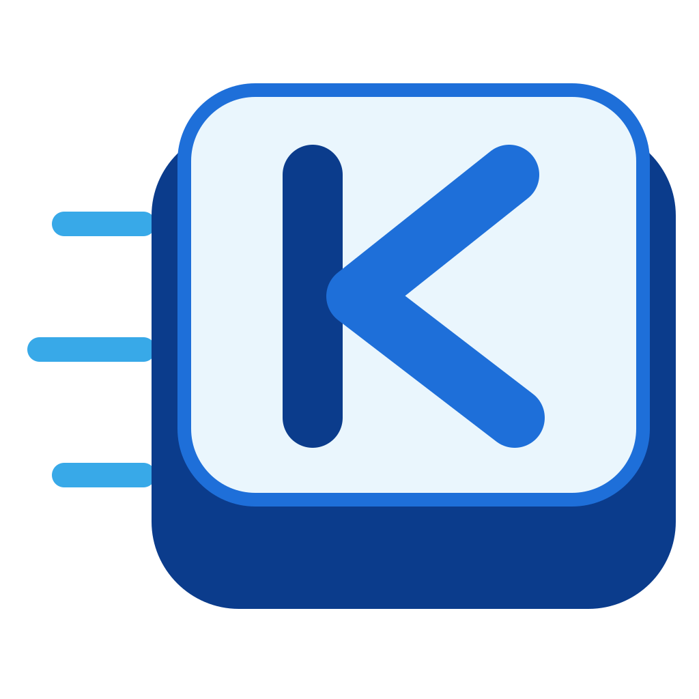

<div align="center">



# Key Rush

**A fast, friendly typing speed test in a single HTML file.**
Four difficulty levels, live WPM and KPM, accuracy tracking and a personal progress graph.
No sign-up, no server, no tracking.

[](LICENSE)
[](index.html)
[](#project-structure)
[](#run-it-locally)

[**Play it live**](https://your-username.github.io/key-rush/) &nbsp;·&nbsp; [Features](#features) &nbsp;·&nbsp; [Run locally](#run-it-locally) &nbsp;·&nbsp; [How scoring works](#how-scoring-works) &nbsp;·&nbsp; [Customize](#customize-it) &nbsp;·&nbsp; [Contribute](#contributing)

<br>


</div>

---

## Contents

- [Features](#features)
- [Screenshots](#screenshots)
- [Run it locally](#run-it-locally)
- [How to play](#how-to-play)
- [How scoring works](#how-scoring-works)
- [Difficulty levels](#difficulty-levels)
- [Your data and privacy](#your-data-and-privacy)
- [Customize it](#customize-it)
- [Project structure](#project-structure)
- [Publish your own copy on GitHub](#publish-your-own-copy-on-github)
- [Contributing](#contributing)
- [FAQ](#faq)
- [Credits and license](#credits-and-license)

## Features

| | |
| --- | --- |
| **Four difficulty levels** | Basic, Medium, Hard and Extra Hard |
| **Four test lengths** | 15, 30, 45 or 60 seconds |
| **Two speed measures** | Paragraph speed in **WPM** and key speed in **KPM** (keystrokes per minute) |
| **Live feedback** | Accuracy and error count update as you type, with wrong characters highlighted |
| **Fresh text every time** | A new paragraph is assembled for each attempt from a pool of 80 sentences, avoiding recent repeats |
| **Progress tracking** | Personal best overall and per level, plus a WPM history graph you can filter by level and time |
| **Saved results** | Stored in your browser's local storage. Still there next time you visit |
| **Light and dark themes** | Light blue with dark blue accents by default, one click to switch |
| **Responsive** | Works on phones, tablets and desktops |
| **Private by design** | No leaderboard, no account, no database, no analytics |
| **Zero dependencies** | One file. No build step, no frameworks, no network requests |

## Screenshots

<table>
  <tr>
    <td align="center"><b>Typing (light)</b><br></td>
    <td align="center"><b>Typing (dark)</b><br></td>
  </tr>
  <tr>
    <td align="center"><b>Results</b><br></td>
    <td align="center"><b>Mobile</b><br></td>
  </tr>
</table>

<details>
<summary>Full dark theme view</summary>
<br>

</details>

## Run it locally

You do not need to install anything.

**Quickest way:** download or clone this repository and double-click `index.html`.

```bash
git clone https://github.com/your-username/key-rush.git
cd key-rush
# then open index.html in your browser
```

**Or serve it** with any static server:

```bash
python3 -m http.server 8000
# open http://localhost:8000
```

## How to play

1. Pick a **difficulty** and a **time**.
2. Click the text box, or simply start typing.
3. The timer starts on your **first key**. Type the text exactly as shown. Wrong characters turn red, and you can fix them with Backspace.
4. When time runs out you get your WPM, KPM, accuracy and error count. The result is saved automatically.

| Key | What it does |
| --- | --- |
| Any character | Focuses the typing box and starts the test |
| `Esc` | Loads a fresh paragraph and resets the test |
| `Backspace` | Corrects a mistake (counts as a keystroke for KPM) |
| `Enter` | After a test, starts a new one |

Copy, cut and paste are disabled in the typing box so every score is earned by typing.

## How scoring works

| Metric | How it is calculated |
| --- | --- |
| **WPM** | Correctly typed characters ÷ 5, per minute. This is the standard "net" typing speed, so mistakes left on screen lower it |
| **Raw WPM** | All typed characters ÷ 5, per minute, right or wrong |
| **KPM** | Every key press per minute, including Backspace |
| **Accuracy** | (Character key presses − mistakes made) ÷ character key presses. A mistake still counts against you after you correct it |
| **Errors** | Number of wrong characters typed during the test |
| **Left uncorrected** | Wrong characters still on screen when time ended |

While a test is running, live numbers use a minimum of 1.5 seconds of elapsed time so the first keystrokes do not show absurd spikes. The final result always uses the full test length.

A test is saved only if you made at least 5 keystrokes, so an accidental run will not pollute your history.

## Difficulty levels

| Level | What you will type |
| --- | --- |
| **Basic** | Short, lowercase sentences made of common words, with no punctuation |
| **Medium** | Everyday sentences with capital letters, commas and full stops |
| **Hard** | Longer sentences with quotes, brackets, semicolons, dashes and numbers |
| **Extra Hard** | Code, dates, prices, file paths, emails and symbols, mixed in with maths |

All text is plain ASCII, so it can be typed on any standard keyboard layout.

## Your data and privacy

Key Rush never sends anything anywhere. Everything lives in your browser's `localStorage` under these keys:

| Key | Contents |
| --- | --- |
| `keyrush.v1.results` | Your last 300 test results (used for the graph and personal best) |
| `keyrush.v1.settings` | Chosen level, time and theme |
| `keyrush.v1.recent` | Which sentences were used recently, to avoid repeats |

Results are tied to one browser on one device. Use the **Clear saved results** button in the app, or clear site data in your browser, to remove them. If your browser blocks storage (some private windows do), the app still works and shows a notice that results will not be saved.

## Customize it

Everything lives in `index.html`, and the settings you are most likely to change sit at the top of the `<script>` block.

**Add your own text.** Find the `POOLS` object and add sentences to any level:

```js
const POOLS = {
  basic:  [ `the sun is up and the dog is out in the yard`, /* add yours here */ ],
  medium: [ /* ... */ ],
  hard:   [ /* ... */ ],
  extra:  [ /* ... */ ]
};
```

Use plain ASCII characters so every keyboard can type them.

**Change durations or level names:**

```js
const LEVELS = { basic: 'Basic', medium: 'Medium', hard: 'Hard', extra: 'Extra Hard' };
const DURATIONS = [15, 30, 45, 60];
```

**Other tunables:** `MAX_RESULTS` (results kept), `GRAPH_POINTS` (tests drawn on the graph) and `MIN_KEYS_TO_SAVE`.

**Change the colors.** Edit the CSS variables at the top of the `<style>` block. Light theme values are in `:root`, dark theme values are in `[data-theme="dark"]`.

```css
:root {
  --primary: #0b3c8c;    /* dark blue accent */
  --primary-2: #1e6fd9;  /* bright blue */
  --bg1: #d8edf9;        /* light blue page background */
}
```

## Project structure

```text
key-rush/
├── index.html           The entire app: HTML, CSS and JavaScript
├── logo.svg             Logo (vector)
├── logo.png             Logo (1024 px) used in this README
├── social-preview.png   1280x640 card for GitHub link previews
├── screenshots/         Images used in this README
├── README.md            You are here
└── LICENSE              MIT
```

## Publish your own copy on GitHub

<details>
<summary><b>Step by step (no Git knowledge needed)</b></summary>

<br>

**1. Create the repository**

1. Sign in at [github.com](https://github.com) and click **+ → New repository**.
2. Name it `key-rush`, set it to **Public**, and click **Create repository**.

**2. Upload the files**

- *In the browser:* on the new repository page click **uploading an existing file**, drag in everything from this project (including the `screenshots` folder), then click **Commit changes**.
- *With Git:*

  ```bash
  cd key-rush
  git init
  git add .
  git commit -m "Add Key Rush"
  git branch -M main
  git remote add origin https://github.com/<your-username>/key-rush.git
  git push -u origin main
  ```

**3. Turn it into a live website with GitHub Pages**

1. Open **Settings → Pages**.
2. Under **Build and deployment**, set **Source** to **Deploy from a branch**.
3. Choose branch **main** and folder **/ (root)**, then click **Save**.
4. After about a minute the game is live at `https://<your-username>.github.io/key-rush/`.

**4. Finish the details**

- Replace `your-username` in the links at the top of this README with your GitHub username.
- In the repository's **About** box (gear icon), add the live link and topics such as `typing-test`, `wpm`, `vanilla-js`, `html`, `css`, `javascript`, `github-pages`.
- Upload `social-preview.png` under **Settings → General → Social preview** so shared links show a nice card.
- Keep the `LICENSE` file so others know they are free to use and adapt the project.

</details>

## Contributing

Contributions are welcome, from a new sentence to a new feature.

1. **Fork** the repository and create a branch: `git checkout -b my-change`.
2. Make your change in `index.html`. Keep it dependency-free and in a single file.
3. Open the file in a browser and try all four levels and both themes. Check a narrow phone width too.
4. Open a **pull request** with a short description, and a screenshot if the look changed.

Good first contributions:

- More sentences for any difficulty level (plain ASCII only)
- Translations of the interface text
- Accessibility improvements
- Bug reports with your browser name and the steps to reproduce

Ideas for the future: custom text input, a sound toggle, per-key error heatmap, export and import of your history as a file.

## FAQ

**Why is my WPM lower than on other typing sites?**
Key Rush reports *net* WPM: only correct characters count, and the result uses the full test length. Raw WPM is shown separately in the results.

**Why did my results disappear?**
Results live in your browser. They are removed if you clear site data, use a private window, or switch to a different browser or device.

**Can I use my own paragraphs?**
Yes. See [Customize it](#customize-it).

**Does it work offline?**
Yes. After you have the file, there is nothing to download.

**Which browsers does it support?**
Any modern browser (Chrome, Edge, Firefox, Safari). It has been tested in Chromium and uses only standard web features.

## Credits and license

Created by **Shubham Gautam**.

Released under the [MIT License](LICENSE). You are free to use, copy, modify and share it, including commercially, as long as the licence notice is kept.

The Key Rush logo is an original keycap-style K mark made for this project and is covered by the same licence.

<div align="center">

If you enjoy Key Rush, a ⭐ on the repository helps others find it.

</div>
